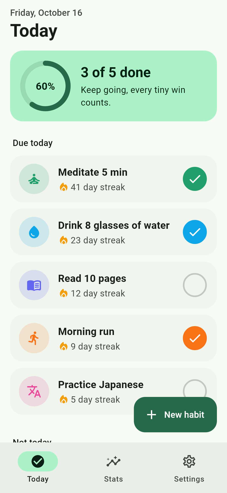
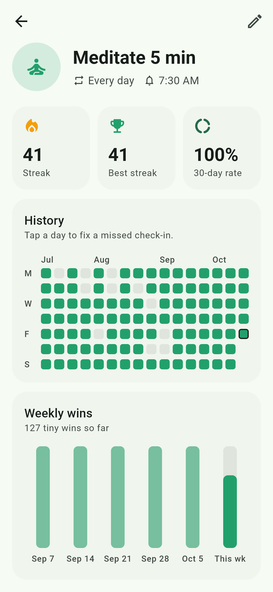
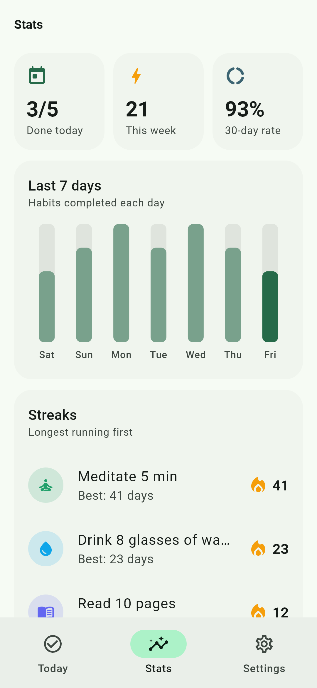
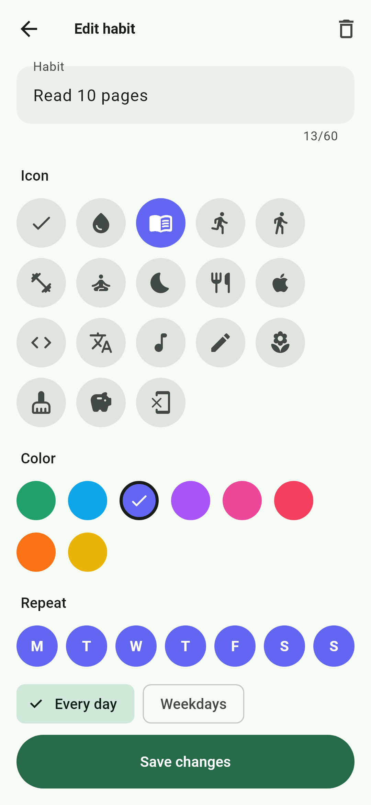
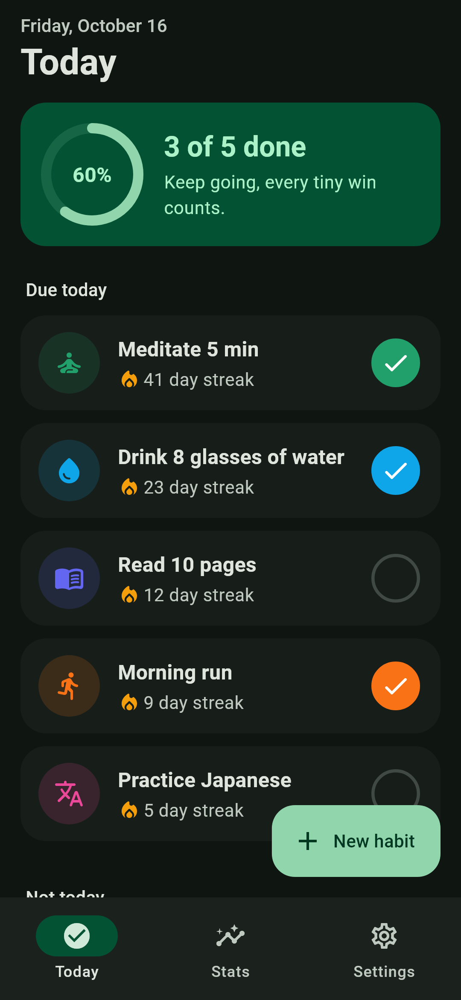

# Tiny Wins

A habit tracker for small daily habits. Check habits off, keep your streaks going and see your progress over time. Built with Flutter for Android and iOS. Everything is stored on the device.

<p align="center">
  
  
  
  
  
</p>

## Features

- **Today**: the habits due today, a progress ring and one tap to check a habit off. Habits that aren't scheduled today are listed separately.
- **Streaks**: the current streak, best streak and 30-day completion rate for each habit.
- **History heatmap**: the last 16 weeks of a habit at a glance. Tap a past day to fix a missed check-in.
- **Charts**: completions per week for each habit, and completions per day across all habits.
- **Flexible schedules**: every day, weekdays, weekends or any set of days.
- **Daily reminders**: a local notification at a time you choose, only on the days the habit is due.
- **Light and dark themes**: Material 3, follows the system setting or can be set by hand.
- **Offline**: data is kept in a local SQLite database. No account needed.

## Tech stack

| | |
|---|---|
| State management | [Riverpod 3](https://riverpod.dev) |
| Database | [Drift](https://drift.simonbinder.eu) (SQLite) |
| Charts | [fl_chart](https://pub.dev/packages/fl_chart) |
| Notifications | [flutter_local_notifications](https://pub.dev/packages/flutter_local_notifications) + [timezone](https://pub.dev/packages/timezone) |
| Settings | [shared_preferences](https://pub.dev/packages/shared_preferences) |

## How streaks work

Streak logic is plain Dart in [`lib/domain/streaks.dart`](lib/domain/streaks.dart) and is fully unit tested.

- Only scheduled days count. A day off neither breaks nor extends a streak.
- Today never breaks a streak. Until it's checked off, it counts as still in progress.
- Days are stored as whole days since 1970-01-01, so time zones and daylight saving can't move a check-in to another day.

## Project structure

```
lib/
├── main.dart                  # Loads settings and notifications, starts the app
├── app.dart                   # MaterialApp and themes
├── core/                      # Theme, day keys, icons, formatting
├── data/
│   ├── database.dart          # Drift tables: habits and completions
│   ├── habit_repository.dart  # Repository interface + Drift implementation
│   └── providers.dart         # Riverpod providers
├── domain/streaks.dart        # Streak and completion rate calculation
├── features/
│   ├── today/                 # Today screen and habit tile
│   ├── habits/                # Detail screen, heatmap, editor
│   ├── stats/                 # Stats tab
│   ├── settings/              # Theme and about
│   └── shell/                 # Bottom navigation
├── notifications/             # Reminder scheduling
└── widgets/                   # Shared cards and bar chart
```

The UI only talks to the `HabitRepository` interface. The tests swap in an in-memory version, so widget tests run without a database or platform plugins.

## Getting started

You need Flutter 3.38 or newer.

```sh
git clone https://github.com/sirine2907/tiny-wins.git
cd tiny-wins
flutter pub get
flutter run
```

If you change the database tables, regenerate the Drift code:

```sh
dart run build_runner build --force-jit
```

## Tests

```sh
flutter test
```

- **Unit tests** for streaks, the completion rate and day keys.
- **Repository tests** against a real in-memory SQLite database.
- **Widget tests** for checking habits off, creating and deleting habits, the detail screen and the stats tab.

## Screenshots

The screenshots above are generated from the real widgets with demo data:

```sh
flutter test screenshots --update-goldens
```
